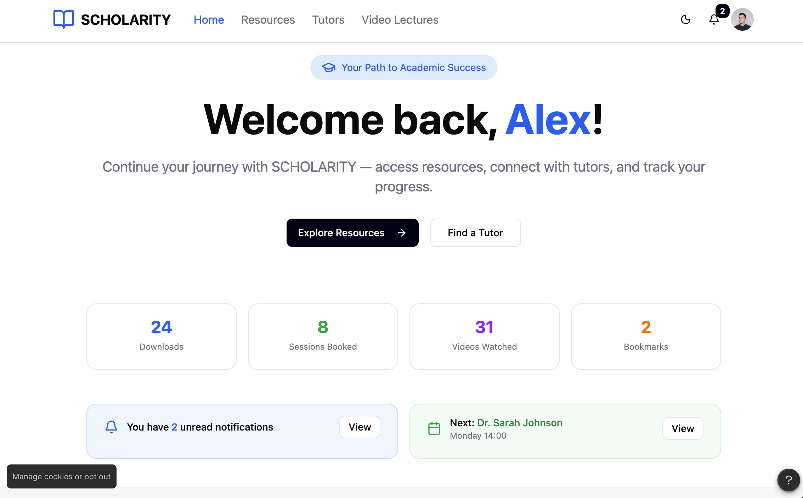
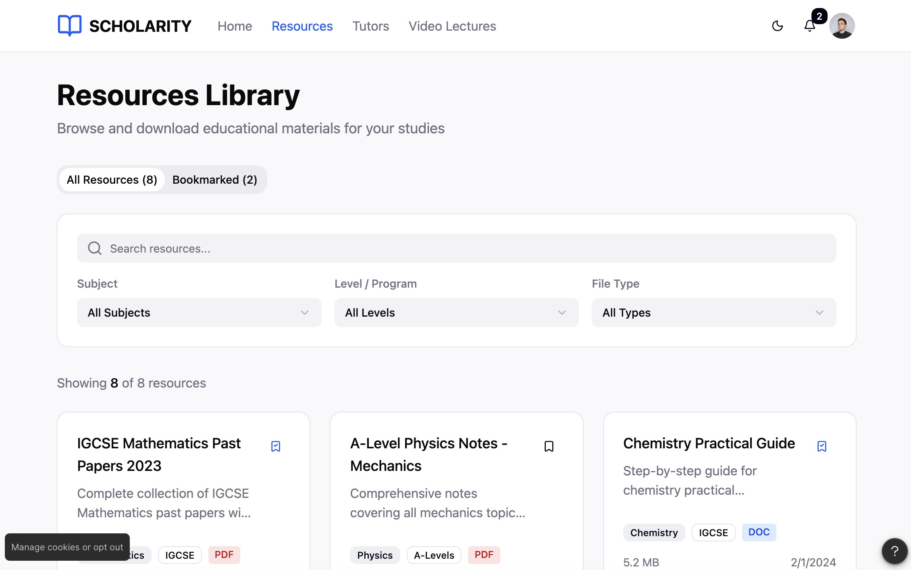
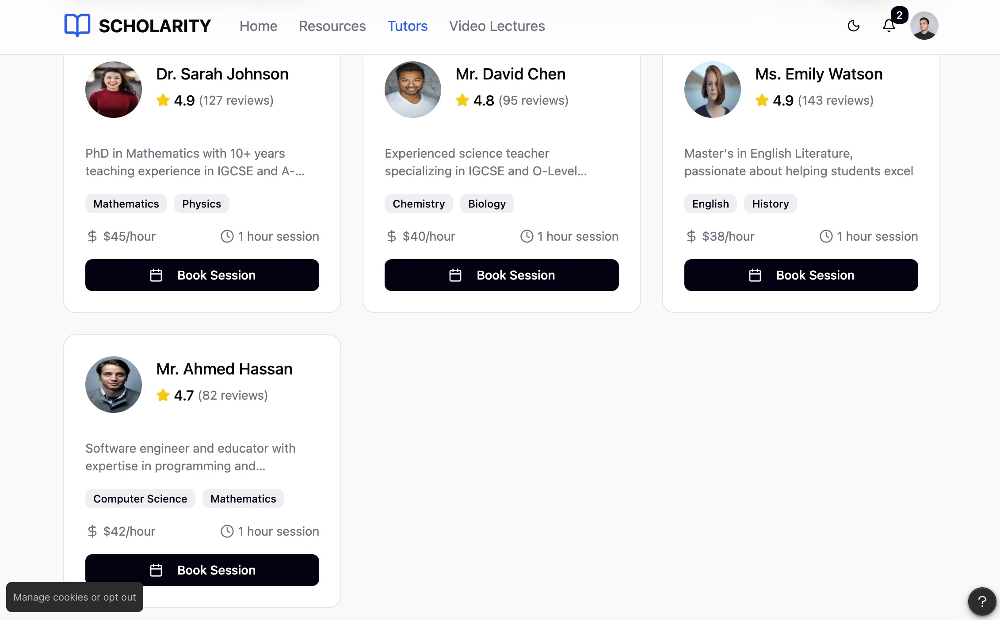

# Scholarity

A student resource platform designed for **SDG 4: Quality Education**. Students pick their programme (IGCSE, A Levels, O Levels, AUSMAT and others) and get the matching past papers, notes, lecture videos and tutors in one place.

Built as a group project for System Analysis and Design at Taylor's University, following the full SDLC: planning, design, prototype and user testing.

## Screenshots

| Dashboard | Resource library |
|---|---|
|  |  |

| Tutors | Video lectures |
|---|---|
|  |  |

## The problem

Study material is scattered across many sites, and much of it does not match the student's course or level. Students lose time searching instead of studying.

## The prototype

- **Dashboard** showing recent activity
- **Resource library** to browse and download learning materials by programme and subject
- **Tutor directory** to view tutors and book sessions
- **Video lectures** with a player, lecture details and downloadable notes

## User testing

The prototype was tested with students and tutors through a structured survey. Most participants found it easy or very easy to navigate, rated the interface 4 or 5 out of 5, and picked the learning materials and resource downloads as the most useful features. Feedback on navigation and visual design is recorded for the next iteration.

Full notes: [planning](docs/planning.md), [testing](docs/testing.md), [summary of results](FINAL/Summary%20of%20Results.md).

## Team

| Role | Members |
|---|---|
| Project Manager | Ahan |
| Lead Systems Analyst | Raiyaan, Aamna |
| Software Architect | Raiyaan, Shaira |
| Quality and Documentation Lead | Aamna, Sally |

Agile process managed on Trello, version control on GitHub.
